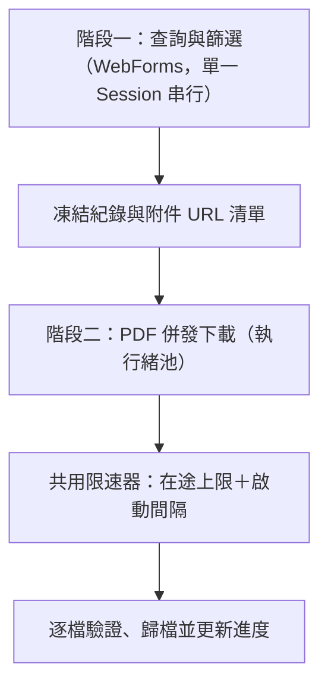

# 國考刷題神器 — 功能與驗收規格（SPEC.md）

## 1. 定位、範圍與文件契約

本工具協助考生查詢考選部公開試題，先勾選精確目標，再下載試題與測驗答案並歸檔。核心流程使用確定性規則，不依賴外部商業 AI API 或 API Key。

搜尋、更新檢查與下載需要網路；已有資料的篩選、命名預覽及檔案整理可離線執行。不得宣稱爬蟲可完全離線運作。

MVP 採 Python 3.10+、Streamlit 本機介面，預設僅監聽 localhost，檔案儲存於執行工具的電腦。遠端多人 Web 部署、OCR、題目全文結構化、申論解答生成與真正 HTTP Range 位元續傳不在 MVP 範圍。未來遠端部署須另定權限、配額及 ZIP／瀏覽器匯出流程。

本文件定義使用者行為與驗收標準；AGENT.md 定義實作約束。變更共同契約時必須同步更新兩份文件；若發現矛盾，先修正契約，不自行猜測。

## 2. 開發前網站驗證

目前文件不代表已實測官方網站。開始完整實作前，先以少量、限速請求確認並記錄：

- 官方入口與下載網域、允許存取的公開範圍及網站使用規範。
- WebForms 實際表單欄位、hidden fields、事件參數、相依選單及是否有分頁機制。
- Session 失效、無結果、錯誤頁與正常結果的辨識方式。
- 考試、類科、科目及附件可用的官方識別碼；附件是否可能拆卷、共用或更新。
- 具代表性的申論、測驗、混合、掃描 PDF 與答案附件；未觀察到的特例標為未驗證。

將觀察日期、來源、去除 Cookie 等敏感資訊的 HTML 樣本與預期解析結果放入 docs/source-validation.md 及 tests/fixtures/。不得把推測的欄位、覆蓋率或速度當成事實。

## 3. 查詢與兩階段篩選

### 3.1 查詢條件

- 年度使用民國整數，包含起訖年度；起年不得大於迄年。可用範圍由來源資料提供，來源無資訊時要求明確輸入。
- 考試名稱／簡稱、類科、科目支援部分字串比對。各欄位之間採 AND；空欄位不限制。
- 只填年度也能查詢。年度範圍必填，避免無界限抓取。
- 原始文字保留；比對鍵採 Unicode NFKC、首尾去空白、連續空白合併，不任意刪除語意字元。
- 簡稱使用版本化明確對照表，未命中時按原字串搜尋，不使用模糊推測。
- 排序為年度＋考試名稱或考試名稱＋年度，另以紀錄 ID 作穩定次排序。
- 官方進階查詢提供考試名稱／類科／科目關鍵字（實測為部分字串比對），可作為縮小傳輸量的前篩；但因本工具另有正規化、簡稱回退與候選聚合規則，而且伺服端篩選結果的類科列以無 checkbox 的 `span` 呈現，**最終篩選仍以本機比對結果為準**，官方篩選只算加速手段，不得當成唯一依據。- **第一階段（查詢表單）即可輸入考試名稱、類科、科目三個關鍵字**，用來決定快照範圍：只保留符合關鍵字的紀錄，第二階段的候選清單因此只列出符合項目。UI 必須顯示查詢範圍（年度與已套用的關鍵字）。
- **共同科目快速查詢模式**：提供 4 組常考共同科目家族預設（國文、法學知識與英文、公民與英文、英文/外國文），送出查詢後自動將科目維度收斂為精確家族名稱，排除子字串偽陽性（如排除「外國文」或「輪機英文」），並啟用下載前試卷層級去重。
- 伺服端關鍵字查詢失敗時，整批改用完整查詢加上本機過濾並記錄警告；同一份快照不得混用兩種查詢範圍。- 官方無法直接處理的條件在完整抓取相關年度資料後本機篩選，UI 顯示查詢範圍。

### 3.2 候選聚合

先取得符合條件的完整 metadata 快照，再提供考試、類科、科目三個候選清單。同欄位多選採 OR，三個欄位之間採 AND，最後選出真實紀錄，不能將候選值任意做笛卡兒組合。

初始選取全部候選。支援全選、全部取消、反選與快速文字過濾；快速過濾僅影響可見項目，上述操作僅作用於可見項目，UI 必須標示。任何必要清單零選取時禁用下載。

候選旁的「份數」定義為目前其他欄位選取條件下，不重複考科紀錄數；另顯示預計試題附件數、答案附件數、不重複試題試卷數（試卷群組去重）及總下載檔數。拆卷可使附件數大於考科數；同一份試卷跨類科只發送一次網路請求並共用實體檔案，內容相同者仍以 SHA-256 安全網共用。

快取 TTL 預設 24 小時，可強制重新查詢，並顯示取得時間。快取鍵包含條件、來源及解析器版本。離線只使用已有快照並明確標示資料時間。

### 3.3 完整性與效能

- 官方查詢為**單次請求回傳條件下全部結果，沒有分頁控制項**。不得實作或依賴不存在的分頁事件；查到分頁元素時視為結構變更並記錄。
- 以**年度為分批單位**逐一年度查詢後合併，合併時依紀錄 ID 去重；每次請求記錄年度、條件、回應特徵與列數。
- 官方單次查詢上限為 **6,000 筆（科目數）**；超過時僅回傳提示文字且結果為 0 列。此情形屬「結果過大／未完整」，不得視為真正的零結果，需縮小年度或條件後重查。
- 完整性採**雙軌核對**：同時記錄官方統計文字（考試／類科／科目數）與實際解析列數。
  - 兩者一致時狀態為「完整」。
  - 若**只有**統計文字與列數不一致，而無解析失敗、上限或錯誤頁，狀態為「**完整（統計差異）**」：仍可下載，但介面必須顯示差異與兩組數字。
  - 若差異來自合併重複列、跨批次去重後對不上，或任何解析異常，則不得降級為「完整（統計差異）」，須標示「結果未完整」並保留兩個數字，不得靜默採用其中一方。
  - 已記錄的已知差異：113 年度官方統計比實際渲染多 1 類科、2 科目（研判為未公布試題的考科，尚無附件可下載）。
- 解析異常、錯誤頁（含以 HTTP 200 回傳的錯誤頁）或必要元素（結果表格、統計文字）缺失時標示「結果未完整」，不得顯示成完整的零結果。只有明確「查無結果」或統計為 0 才算零結果。
- 另有可設定的安全上限（年度批次數、總筆數）；達上限或批次失敗時標示「結果未完整」。
- 未完整快照不開放批量下載；使用者可重試或縮小條件。
- 不承諾首次查詢的完成秒數（單一年度回應可達 6 MB 以上）。顯示已取得的年度、筆數及取消按鈕；取消後不再派發請求。快取命中與首次查詢分別量測。
- 勾選確認後凍結快照與紀錄 ID，下載不重新執行廣泛搜尋。

## 4. 資料、附件與題型

一個 ExamRecord 表示一筆來源考科紀錄，對應零至多個 ExamAsset。紀錄保留年度、考試全名、類科、科目、等別、來源頁、官方 ID（若有）及內部穩定 ID。簡稱與等別可為未知，不能憑文字猜出不存在的資料。

附件角色為 QUESTION、CHOICE_ANSWER、OTHER；保留原始標籤、URL、官方附件 ID（若有）、版本／觀察時間。未知角色不得自動當作答案下載。MVP 下載已確認角色的 PDF，其他格式列出不支援原因。

官方 ID 優先作識別；缺少時以來源上下文、原始欄位與附件參照產生穩定雜湊，記錄識別策略版本。同名不代表同一紀錄；URL 正規化不得任意移除有意義的 query 參數。

### 4.1 保守題型判定

題型列舉為 ESSAY（申論題）、CHOICE（測驗題）、MIXED（混合題）、UNKNOWN（未確認）。每個試題附件獨立保存題型、判定來源、規則版本及原因。

- 答案連結存在只表示該考科有測驗部分，不能區分純測驗與混合；沒有答案連結不能證明純申論。
- 有明確且已驗證語意的官方標籤時可據此判定，否則保持 UNKNOWN。
- 下載後以 pypdf 抽取第一頁文字，檢查前 300 個字元。這是文字抽取後截斷，不是保證只解析 300 個字元，也不保證對應頁面視覺頂部。
- 明確混合證據優先；單獨出現「單一選擇題」不能排除申論部分。純測驗／純申論須有排他性指示，例如「全部為測驗題」或「全部為申論題」。規則須由 fixture 驗證。
- 無文字層、證據不足或互相衝突時保留 UNKNOWN 或先前可靠證據；衝突狀態標示待確認，不靜默覆蓋。
- 不執行 OCR、不掃描後續頁面。嗅探使用可終止的工作程序，預設逾時 5 秒；失敗不阻擋已驗證有效 PDF 的歸檔。
- 不承諾 95% 覆蓋率或 100% 準確率。發布前以標註樣本報告正確率、未知率與耗時分位數，附樣本數、環境與規則版本。

### 4.2 試題與答案關係

試題與答案依來源紀錄／官方關聯配對，不靠相似檔名猜測。拆卷以多個 QUESTION 附件表示；缺少答案時只下載存在的附件，不建立空檔。

答案永遠命名為「測驗答案」，不得暗示包含申論解答。找不到明確試題配對的答案標示關聯未確認，保留在原考科紀錄下。

官方另有「更正答案」（`t=M`）附件，與原答案同屬測驗答案角色但內容不同；同一考科可同時有多個答案附件，歸檔時必須以穩定附件 ID 消歧，不得互相覆寫，也不得把更正答案當成新的考科紀錄。

## 5. 路徑與命名

更新相容性：控制器初始化及 session 復用必須檢查控制器、任務服務介面版本（目前為 `CONTROLLER_API_VERSION = 8`、`EXPECTED_TASK_SERVICE_API_VERSION = 4`）與匯出方法。版本不符時顯示「程式已更新，請重新啟動應用程式後重新查詢及下載」，停止新任務、重試與 ZIP 匯出；不部分重載模組或替換既有背景服務。完整程序重啟後重新建立任務，保留檔案與 manifest，不猜測舊任務範圍。

路徑預覽在計算後會自動套用試卷收斂（`collapse_shared_paper_paths`），同一份試卷跨類科在預覽中只列出代表檔案，避免預覽清單膨脹，並顯示警示提示實際建立檔案數。

ZIP 匯出以任務提交時的選取為範圍，只收錄該任務成功處理的附件（包含驗證後略過下載及共用既有檔案），不得掃描全部歷史題庫。任務保存附件 ID 與最終相對路徑；部分完成只匯出成功部分，重試累積先前成果，後續篩選不改變原任務範圍。同一實體路徑只收錄一次；檔案遺失、為空或解析後超出下載根目錄時停止整包匯出並說明原因。保留分類與中文檔名，顯示實際打包檔案數；雲端 ZIP 與該次下載的根目錄同名（`國考題庫_YYYYMMDD_HHMMSS.zip`），本機 ZIP 檔名包含任務識別與時間。既有 PDF 與查詢快取不刪除，無需資料庫遷移。

雲端模式的根目錄位於系統暫存目錄下，名稱為 `國考題庫_YYYYMMDD_HHMMSS`（按下「開始下載」的當下時間，含秒數），每次下載各自獨立，避免不同使用者的題庫與下載紀錄互相混用；下載前側邊欄的歸檔結構預覽顯示 `國考題庫_YYYYMMDD_HHMMSS` 佔位名稱，下載後顯示實際根目錄，未下載任何檔案的舊工作階段根目錄會自動清除。

提供三種預設與一種自訂模式，均以使用者選定的下載根目錄為基準：

| 模式 | 相對路徑模板 |
| --- | --- |
| A 依科目（預設） | `{科目}/{年度}_{考試名稱}_{類科}_{題型}.pdf` |
| B 依年度考試 | `{年度}/{考試名稱}_{類科}/{科目}_{題型}.pdf` |
| C 平鋪 | `{年度}_{考試名稱}_{類科}_{科目}_{題型}.pdf` |
| D 自訂 | 使用下列允許變數與相對目錄 |

變數契約：`{年度}` 固定純民國數字，`{年度標籤}` 為「112年」；`{考試名稱}` 保留官方全名；`{考試簡稱}` 未建立對照時回退全名；`{類科}`、`{科目}` 使用來源值；`{等別}` 缺少時為「等別未確認」；`{題型類別}` 為申論題／測驗題／混合題／未確認；`{題型}` 為申論試題／測驗試題／混合試題／試題／測驗答案。

自訂模板須包含 `{題型}` 作為檔名末段，並以 `.pdf` 結尾。拒絕未知變數、格式運算及任意程式求值。下載前顯示預覽；題型尚未知的路徑標示暫定。

同考科試題與答案共享主檔名前綴；多附件或碰撞時在角色後綴前加入穩定紀錄／附件短 ID，不覆寫其他附件。保證同群組前綴，不宣稱所有檔案管理員排序下必然相鄰。

`{題型類別}` 對答案採考科已確認的整體題型，無法確認時使用「未確認」。使用此變數可能使拆卷分處不同資料夾，UI 預覽須顯示此結果；配對關係以 manifest 為準。

模式變更與既有檔案：使用者變更歸檔模式或模板後，已完成且驗證完好之附件若 manifest 路徑與新目標路徑不同，**必須搬移既有檔案，不得只複製後保留舊檔**。搬移成功後須刪除舊檔並清除因此變空的資料夾（根目錄、`.parts` 與 manifest 目錄除外）。新目標已有相同 SHA-256 內容時可移除舊檔並沿用新檔；內容不同時不得覆寫，須改用帶內容雜湊的版本檔名。`version > 1` 的既有版本檔搬移時須保留原內容雜湊後綴。內容去重共用檔僅允許 `dedupe_of` 擁有者搬移，並同步更新所有指向舊路徑的附件與版本紀錄；非擁有者不得搬移。

路徑安全要求：逐段清理非法字元、控制字元、尾端空白／句點與 Windows 保留名稱；拒絕絕對路徑、磁碟機／UNC 路徑、空段與 `.`／`..`。解析後確認最終位置仍在下載根目錄內，包含符號連結／junction 情境。NFKC 正規化及大小寫不敏感比較後仍須偵測碰撞。超長路徑使用可設定長度限制與穩定 ID 縮短；每段除字元數上限外，另以 UTF-8 位元組上限截斷（中文字每字 3 位元組，單靠字元數上限仍可能超過檔案系統 255 位元組的段上限而觸發 `ENAMETOOLONG`）；不可安全建立時明確報錯。

## 6. 下載、版本與恢復

流程：凍結 metadata → 暫存下載 → 驗證 PDF → 題型嗅探 → 計算最終路徑 → 原子歸檔 → 更新 manifest。

- 暫存檔放在下載根目錄同一檔案系統內，使用附件 ID 命名 `.part`，不以最終檔名表示完成。
- 必須驗證成功狀態、實際內容不是登入／錯誤 HTML、PDF 特徵及解析可讀性；Content-Type 只是輔助資訊。
- 有可比較的 Content-Length 時比對實際傳輸長度；串流／壓縮回應不能錯比解壓前後長度。缺少長度仍須通過格式驗證，不能僅因非零就接受。
- 預設附件上限 100 MiB，串流累計超限立即停止並記錄原因；設定可調整。
- manifest 使用 SQLite，記錄紀錄與附件 ID、URL、快照、狀態、路徑、大小、SHA-256、ETag／Last-Modified（若有）、版本及錯誤。
- 只有 manifest 已完成且本機大小與雜湊相符才可略過。既有但未追蹤檔案不得盲目採用或覆寫。
- **內容去重**：先下載才能知道 SHA-256（請求層面仍依 URL 去重）；若新下載內容與另一筆已完成的附件完全相同且該檔完好，則不重複寫入，新紀錄直接指向既有路徑，並在 manifest 記錄 `dedupe_of`（來源附件 ID）。既有共用檔不存在或雜湊不符時不得共用，必須自己寫一份。驗證、題型嗅探與 URL／長度檢查仍對新下載執行；共用只影響磁碟落點。
- 「預計歸檔檔案數」以附件數估算；實際檔案數可能因內容去重而較少，介面必須明示。
- 提供「檢查官方更新」：有驗證器時使用條件請求；無驗證器時重新下載比較雜湊。內容更新保留舊版，新增帶內容雜湊的版本檔名。
- **模式變更與整理**：變更歸檔模式／模板後，提供可重複執行的「依目前模式整理已下載檔案」，依 manifest 已記錄題型重算路徑並搬移，不重新下載、不重新嗅探 PDF。整理只能刪除內容與某個已追蹤檔案完全相同、且已不再被追蹤的舊 PDF；不得刪除內容不同的使用者檔案。下載任務執行中不得變更歸檔模式、根目錄或併發數。
- 恢復指重新啟動後略過已驗證完成附件、重試未完成附件；MVP 不保證從 `.part` 位元位置續傳。
- 檔案與資料庫不能視為同一原子交易；啟動時核對暫存、已歸檔檔案與 manifest，修復歸檔成功但狀態未提交的中斷。
- 下載失敗不刪除已完成試題。試題成功、答案失敗顯示「部分完成」，可只重試失敗附件。

## 7. 網路與任務狀態

所有對同站點的查詢、下載、更新檢查共用限速器：在途請求上限預設 2（可設定 1～4，見 §7.1），全域請求啟動間隔隨機 0.5～1.5 秒。同一 WebForms Session 的查詢事件串行，不並行使用可變表單狀態。

httpx.Client 維持 Cookie；每次依最新回應收集完整表單 hidden fields（含可能分段的 ViewState），並依實際控制項發送事件與選取值，不硬編碼只有三個 hidden fields。實測 `__VIEWSTATE` 可達數十萬字元，必須完整保留。

下拉選單的變更必須以 `__EVENTTARGET` 觸發 postback 後再送出查詢：實測直接 POST 帶入起迄年時，年度（迄）**不會生效**，只會回傳起年資料。

錯誤頁可能以 HTTP 200 回傳（例如 `htmNotFoundPage.htm?aspxerrorpath=...`，標題「您所輸入的網址並不存在！」），必須檢查最終網址、標題與必要元素，不得只看狀態碼。

預設連線逾時 10 秒、讀取逾時 30 秒；最多 3 次重試（總計 4 次嘗試），指數退避基底 1 秒、上限 30 秒，另加 jitter。429／503 尊重 Retry-After；持續限流暫停任務並提示稍後重試。403 不視為限流而盲目重試，應停止對該來源的新請求並記錄原因（可能是權限或存取條件不符）。404 等永久錯誤不盲目重試。POST 遇失效狀態先重建 Session 並重播已驗證的查詢步驟，最多 1 次；不重送過期 ViewState。

只允許經驗證的官方來源／下載網域及 HTTP(S)，重新導向的每一跳重新驗證目標，拒絕任意內網／本機目的地。憑證錯誤不得關閉 TLS 驗證繞過。

### 7.1 分階段併發策略

查詢與下載採「動靜分離」，兼顧速度與站點禮貌：

- **查詢階段（WebForms 查詢頁）**：維持單一 Session 串行請求，每次依最新回應更新 hidden fields，不並行使用可變表單狀態；多年度以逐年查詢、序列送出。
- **下載階段**：確認後凍結附件 URL 清單，再以執行緒池（Python 內建 `concurrent.futures.ThreadPoolExecutor`）併發下載。下載前必須確認該 URL 是否需要 Cookie、是否會重新導向或另有存取限制，不得假設全部附件都是無狀態的靜態檔。
- **初始併發數**：預設 2，可設定 1～4；小樣本實測後才可調高。本文件不宣稱固定併發數「不會被 WAF 封鎖」：目前沒有考選部 WAF 規則、封鎖時間或安全併發門檻的實測證據，瀏覽器會並行下載也不能證明爬蟲同樣不受限。
- **共用限速器仍為強制**：以全域單一節奏為準（不讓各 worker 各自計時），在途上限與啟動間隔同時生效；併發不等於放寬限速。
- **有界派送**：同時提交至執行緒池的工作數須受上限約束，便於取消時停止派發，不得一次將全部附件丟進池中。
- **失敗隔離**：每個 future 各自捕捉例外，單一附件失敗不得中斷其他結果的收集；重試仍受 §6 的附件層級語意約束。
- **完成判定**：驗證與歸檔完成才計入成功數，進度顯示「已完成 N／總數」、各附件狀態與失敗重試入口。
- **效能說明**：以全域啟動間隔 0.5～1.5 秒估算（平均約 1 秒），60 份附件光派送就約 59 秒，加最後一份傳輸約 59.8 秒，尚未含查詢、驗證與重試，因此不承諾 10～12 秒完成。併發收益主要出現在單份傳輸時間較長時；實際幅度由 P2-5 小樣本量測決定，不得作為驗收門檻或對外宣稱。

任務狀態：待開始、查詢中、待勾選、下載中、取消中、已取消、完成、部分完成、失敗。附件狀態：待下載、下載中、驗證中、已完成、已略過、失敗、已取消。

取消時停止派發新工作，關閉進行中的串流並保留已完成檔案；UI 定期更新且避免重複提交。日誌記錄事件碼、任務／附件 ID、錯誤分類，不記錄 Cookie、完整表單 token 或敏感 query 值。

## 8. 驗收與交付順序

1. 網站驗證及 fixture：確認來源結構，記錄尚未驗證的特例。
2. 查詢與完整快照：測試年度批次合併去重、重複列去重、官方統計核對、6,000 筆上限、統計不符、Session 失效、無結果與解析失敗的區別。3. 安全下載與恢復：測試 HTML 偽裝成功、截斷／損壞 PDF、缺少長度、超限、取消、斷線、重啟、更新與同名不同附件。
4. 題型及預設歸檔：測試缺答案仍 UNKNOWN、拆卷、掃描頁、衝突、只讀首頁、嗅探逾時與答案標籤。
5. UI 與自訂模板：測試 AND／OR、候選份數、零選取、快照不完整禁用下載、部分成功重試、路徑逃逸與碰撞。
6. 模式變更與整理：測試既有檔案搬移、舊空目錄清除、共用檔擁有者搬移、版本檔保留內容雜湊、目標碰撞不覆寫、檔案占用錯誤，以及整理／清理可重複執行。
7. UI 狀態分支與靜態檢查：所有附件狀態分支（完成、略過、共用、搬移、失敗、不支援、取消）須有渲染測試；並以 pyflakes 等靜態檢查確認 `app/` 沒有未定義名稱，避免罕見分支拋出 `NameError`。

常規測試使用離線 fixture 與模擬 HTTP，不依賴即時官方網站。端到端驗收使用小樣本、限速執行並保存日期與結果。效能報告區分快取／首次查詢及 PDF 大小，不使用固定 50ms 作為所有環境的通過門檻。
